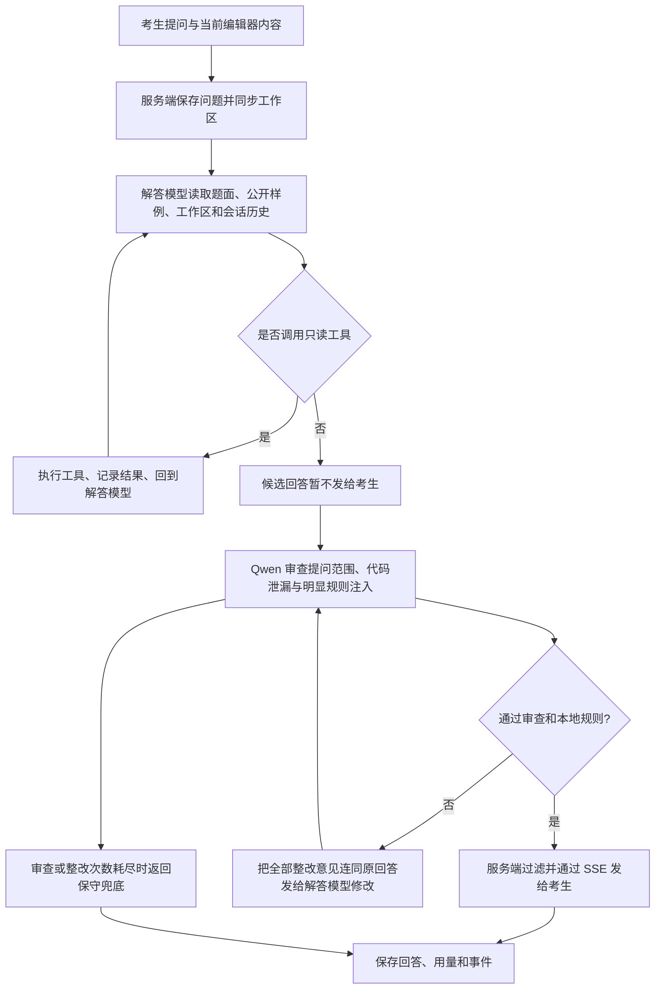

# AI 按需辅导实验：设计、实现与使用

本文件描述 `ljy_feat/agent-learning-experiment` 分支截至 2026-11-26 的实现。目标是让助教针对考生**当下问到的范围**提供帮助，并在会话结束后描述考生请求和获得了哪些帮助。它是学习过程分析的实验实现，不自动给学生打分。完整的真实对话见 [AI按需辅导完整对话示例.md](AI按需辅导完整对话示例.md)。

## 1. 交互设计

考试沿用原项目的三种 AI 模式，权限由考试配置决定：

| 考试模式 | 会话级别 | 当前行为 |
| --- | --- | --- |
| 关闭 `closed` | `none` | 不建立可对话的 AI 会话。 |
| 受限 `limited` | `advise` | 可以读题面、工作区、自己的提交并运行公开样例；按当前问题答疑，不能写工作区或给整题代码。 |
| 开放 `open` | `edit` | 保留原有协作模式，可以使用写文件工具修改工作区。 |

受限模式的帮助深度随问题变化。问概念，应把概念解释清楚，必要时使用一个小例子；问算法构思，说明被问到的结构、条件或步骤的作用；只问报错原因，定位原因和检查位置；明确指出某一行、变量或错误并问如何修改时，才允许一处短的局部实现示例。泛泛索要整题答案时，不给完整函数、程序或逐步拼出的整题实现。考生无需在问题里主动写“不要给代码”。

“问多少答多少”包含**广度**和**深度**两层边界。比如只问“应该关注哪些部分”，回答应指出这些部分及其重要性，不主动替考生推导每一部分的最终判定和完整处理过程。要把新概念讲到初学者能理解，同时在回答当前问题后停止。此规则不包含任何特定题目的算法或关键词。

## 2. 一轮受限对话如何运行



服务端的 `build_system_prompt` 组装题面、公开样例和工作区上下文。解答模型可以使用 `list_files`、`read_workspace`、`get_problem`、`list_submissions`、`run_sample_tests`；这些工具由服务端执行，不能读取隐藏测试。受限模式的工具列表根本不包含 `write_file`，因此模型的文字指令不能使它获得写权限。前端编辑器内容会作为当前工作区快照传到后端；会话按“考试、学生、题目”唯一，可以续聊。

候选回答先由另一模型结合题面审查，再交由本地确定性规则检查明显的代码块、多条可执行语句和不合请求的局部实现。学生只问“应检查哪些对象或情况”时，生成前会附加本轮范围约束；本地规则拦截多条判定条件、直接结论或擅自排除其他检查范围的说法。即使语义审查通过，服务端也只从列表中保留简短的检查对象名称，避免把多余解释或错误判定转发给学生；没有可提取列表时仍走审查、整改和安全兜底。学生明确追问如何判断时不套用这条窄范围规则。审查模型返回 `allowed`、合并后的 `feedback`、`user_attack` 和原话证据。只有明显要求忽略规则、伪造权限等才标为刻意诱导；普通的“怎么写”“讲具体点”不视为攻击。疑似诱导会写入审计日志，考生收到留痕提示。审查失败会重试，仍不可用时给出安全提示。整改最多两轮；整改时把上一版回答与全部审查意见交回解答模型，要求保留切题内容并删掉越界部分，避免重新求整题。

首轮解答保留模型默认思考；审查、整改和报告默认关闭思考，`httpx` 客户端复用连接。后端在审核完成前不向前端流出受限模式的候选正文，因此前端会先显示“正在生成并审核回复…”，然后通过 SSE 接收 `delta`、`usage`、`done` 等事件。开放模式仍可直接流式输出和使用写工具。

这是一套多层约束和回归机制，**不能把模型审查结果当成形式化正确性保证**。审查模型也可能放行较宽的算法指导；应继续用不同题型和真实学生问题检验回答边界。

## 3. 学习过程报告

`agent_help_report <session_id>` 根据该会话的学生提问和助教回答生成两部分 JSON：

- `studentReport`：按知识、算法、编程、调试等领域统计提问次数，概述主要问题、实际获得的回答、反复追问、有证据的自主活动和证据限制。没有代码或后续验证时，不猜测学生是否独立完成或已经学会。
- `systemReview`：逐轮记录学生请求深度、实际得到的帮助深度、来自学生原话的短证据，以及过度/不足帮助的轮次。这部分供内部审查，不应当作学生报告展示。

深度 0～4 依次为无帮助、概念/思路、算法设计/调试方向、明确局部实现/修错、完整解法。现阶段是**试验性描述报告**：由管理命令生成，尚未接入学生成绩页，也没有自动评分规则。考生端只展示对话和用量；不能把页面原有的“过程评分”提示理解为该报告已经计入分数。

## 4. 本地使用

以下命令从仓库根目录执行，适用于 PowerShell。题目由教师在后台创建并组卷；仓库不会自动附带本文回归时下载的 LOJ 原题和测试数据。

```powershell
cd backend
py -m venv .venv
.\.venv\Scripts\python.exe -m pip install -r requirements.txt
Copy-Item .env.example .env
# 用编辑器在 backend/.env 中填写自己的密钥和网关地址；该文件已被 Git 忽略。
.\.venv\Scripts\python.exe manage.py makemigrations user problem exam agent
.\.venv\Scripts\python.exe manage.py migrate
.\.venv\Scripts\python.exe manage.py init_db
.\.venv\Scripts\python.exe manage.py runserver 127.0.0.1:8000
```

`backend/.env` 至少配置 `AGENT_PROVIDER=deepseek`、`DEEPSEEK_API_KEY`、`DEEPSEEK_BASE_URL`、`AGENT_MODEL`，以及 `AGENT_GUARD_MODEL=Qwen3.8-Flash`。这里的 `deepseek` 是代码里的 OpenAI 兼容 provider 名称；模型和网关由配置决定，审查与报告可以使用不同模型。不要把密钥写进代码、文档或提交记录。若只想验证页面和接口，可用 `AGENT_PROVIDER=mock`，但 mock 无法验证真实回复质量。

另开一个 PowerShell 窗口：

```powershell
cd frontend
npm install
npm run startwithoutbrowser
```

访问 `http://127.0.0.1:3001`，用 `init_db` 创建的测试账号登录；教师创建算法题、添加公开/隐藏样例、组卷并把 AI 模式设为“受限”，学生进入工作台后即可对话。报告在后端窗口运行：

```powershell
cd backend
.\.venv\Scripts\python.exe manage.py agent_help_report <会话ID>
```

会话 ID 可从 `/api/v1/agent/sessions` 的响应或教师端会话转录中取得。常用验证命令：

```powershell
cd backend
.\.venv\Scripts\python.exe manage.py test agent
.\.venv\Scripts\python.exe manage.py test
cd ..\frontend
$env:NODE_OPTIONS='--openssl-legacy-provider'
$env:CI='true'
npm run build
```

## 5. 主要代码位置

| 文件 | 职责 |
| --- | --- |
| `backend/agent/service.py` | 组装上下文、运行模型与工具轮次、审核整改、SSE 输出及用量留存。 |
| `backend/agent/guard.py`、`policy.py` | Qwen 语义审查、本地代码兜底及局部提问检测。 |
| `backend/agent/levels.py`、`tools.py` | 考试模式到工具权限映射、工具实现。 |
| `backend/agent/report.py` | 根据实际问答生成有证据的学生报告和内部审查数据。 |
| `backend/agent/providers.py` | mock/兼容网关调用、流式事件解析、连接复用和用量提取。 |
| `frontend/src/pages/student/WorkbenchPage.tsx` | 考生工作台的 AI 对话、状态、工具记录和代码修改展示。 |

## 6. 本次跨题验证的范围

2026-11-26 从 [LOJ Test Round #4 的 C 题“尘封思绪”](https://contest-archive.loj.ac/contest/20/problem/3/) 官方归档页下载题面，在本地数据库转述导入并配置原题公开样例；导入脚本与完整试验原始数据保存在被 Git 忽略的 `backend/tmp/`，不会推送。与先前使用的区间修改/树状数组题不同，这题检验相邻关系和填数构造。真实 HTTP/SSE 会话已覆盖概念、检查对象、局部算法作用和 `IndexError` 诊断，并生成报告。全套后端测试、前端生产构建和页面操作另在提交记录中验证。
