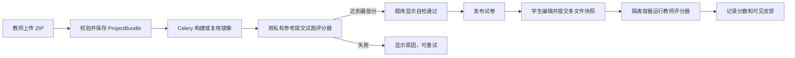

# 工程题上传与测评 v1

本文面向项目成员，描述当前已经实现的工程题链路。平台负责题包格式、环境准备、学生多文件工作区与隔离判题；教师负责具体作业内容和评分标准。Arch Lab 只是示例，平台代码没有为它写专门分支。

## 职责划分

| 角色 | 需要提供或完成 |
| --- | --- |
| 教师 | 题面、公开初始文件、私有测试和评分脚本、依赖、参考提交、自检最低分 |
| 平台 | 校验 ZIP、构建并缓存镜像、试跑参考提交、展示状态、保存学生文件快照、执行评分、记录结果 |
| 部署方 | 通用 Docker 服务、任务队列、基础镜像和机器资源；普通模式不逐题安装工具 |

## 教师题包

```text
project.json                 题面、环境、评分命令和分值
public/                     学生看到并编辑的 UTF-8 文本
private/grade.py             教师评分入口
private/tests/               可选的隐藏测试资源
private/selfcheck/           教师参考提交，路径对应 public/
private/Dockerfile           可选的高级环境入口
private/build/               Dockerfile 使用的构建文件
```

普通入口在 `project.json` 中写 `environment.systemPackages`（Debian 包）和 `environment.pythonPackages`（pip 包），以及 `graderCommand`、`maxScore`、`selfCheckMinScore`。例如：

```json
{
  "title": "工程题标题",
  "description": "Markdown 题面",
  "language": "python",
  "difficulty": "hard",
  "environment": {
    "systemPackages": ["gcc", "make"],
    "pythonPackages": ["Django==4.2.5"]
  },
  "graderCommand": ["python3", "private/grade.py"],
  "maxScore": 100,
  "selfCheckMinScore": 80
}
```

教师评分器从 `PROJECT_SUBMISSION` 读取学生文件，从 `PROJECT_PRIVATE` 读取隐藏资源，向 `PROJECT_RESULT` 写 JSON。结果至少有 `score`、`maxScore`、`items`；每个评分项有数字 `score`、`maxScore` 和布尔值 `visible`。`needsReview` 可以标记待复核，目前尚无人工补分界面。平台按“题目得分 ÷ 题目满分 × 试卷中该题分值”折算。隐藏评分项的名称和反馈不会下发给学生。

高级入口在题包中放 `private/Dockerfile` 和可选的 `private/build/`，此时不写 `environment` 或 `runtime`。镜像必须提供 `/bin/sh` 和 `python3`，供平台通用 runner 使用。旧的预置 `runtime` 入口仍兼容，但没有自动构建和参考提交自检。

## 完整流程



上传时 `backend/problem/project_package.py` 校验路径穿越、重复路径、符号链接、容量、UTF-8 和配置。`ProjectBundle` 保存 ZIP、公开文件、环境、镜像名与准备状态。`backend/judge/project_environment.py` 根据依赖声明构建镜像，并把 `private/selfcheck/` 覆盖到初始文件上试跑评分器。低于教师设置的最低分时标记失败。`backend/exam/controllers.py` 阻止未通过自检的题随试卷发布。

学生端从 `publicFiles` 建立多文件工作区，提交时保存各文件当前内容。`backend/judge/project_sandbox.py` 把题包和提交送入一次性容器；判题包会剔除参考提交、Dockerfile 和构建文件。容器禁网络、限制 CPU/内存/进程数，运行通用 Python runner，再调用教师的评分命令。结果按协议校验后记入提交记录；临时容器和卷在判题后删除，镜像复用。

## 环境入口与已知边界

| 入口 | 教师要写什么 | 适用范围 |
| --- | --- | --- |
| 普通依赖清单 | Debian/Python 包名 | C/C++、Python/Django 等可由 apt/pip 准备的题；Arch Lab 和不含浏览器测试的 BBS 已验证 |
| 教师 Dockerfile | Dockerfile、必要的构建文件 | 特殊基础镜像、工具链或多步预安装 |
| 预置 runtime | 部署方配置的镜像名称 | 旧题兼容，没有自动自检 |

ZIP 上限 8 MB、解压总量 32 MB、公开文本总量 1 MB、文件数 512；参考提交最多 100 个文件、200 KB。学生一次提交最多 100 个文件、200 KB。默认单次判题墙钟上限 110 秒，容器限制 768 MB、1 CPU、64 个进程。工作区只支持 UTF-8 文本，不支持二进制文件或只读公开文件。Node 包、浏览器等目前没有普通依赖字段，可以走高级入口，但浏览器端到端测试尚未验证资源和时限。镜像构建经判题 worker 的 Docker daemon 进行，当前没有独立构建服务、镜像审计或完整构建日志页面。修改题包内容需重新导入；重试只重新准备同一个包。

## 代码与实测

- `backend/problem/`：模型、上传 API、题包校验及准备状态。
- `backend/judge/`：环境构建、容器判题与异步任务。
- `backend/exam/`：发布拦截、学生题目投影、分数折算。
- `frontend/src/pages/teacher/ProblemBankPage.tsx`：教师上传与状态展示。
- `frontend/src/pages/student/WorkbenchPage.tsx`：学生多文件编辑与提交。

Arch Lab 普通入口真实容器自检得 87.8/100。SimpleBBS 测试任务的普通入口和 Dockerfile 入口均通过真实构建与评分，教师参考提交 95/100、原始待做题包 5/100；该演示不含浏览器端到端测试，也不是课程官方评分器。后端 `problem` 测试 16 项通过，`exam` 和 `judge` 测试 41 项通过（7 项跳过），前端生产构建通过。
